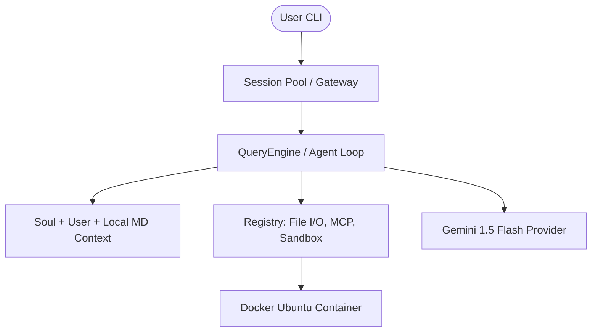

# 🌌 Black Forge : The Personal Agent OS & Marketing Framework

[](https://www.python.org/downloads/)
[](https://deepmind.google/technologies/gemini/)
[](https://github.com/langchain-ai/langgraph)
[](https://opensource.org/licenses/MIT)

> **Black Forge** is a modular, high-fidelity Personal Agent architecture designed to bridge the gap between LLM reasoning and local system execution. It combines an adversarial **AutoReason** marketing engine with a sandboxed **Agent OS** foundation.

---

## ✨ Features

- 🧠 **Adversarial Optimization (AutoReason)**: An optimization loop that uses Critic and Judge agents to iteratively refine marketing copy until it survives blind evaluation.
- 🛡️ **Docker-Sandboxed CLI**: Safely execute shell commands and file operations within isolated Ubuntu containers.
- 📂 **MCP (Model Context Protocol)**: Ready for external tool synchronization via standard JSON-RPC.
- 💾 **Multi-Layer Memory**:
    - **Global Persona**: Core identity stored in `~/.black_forge/soul.md`.
    - **User Preferences**: Persistent settings in `~/.black_forge/user.md`.
    - **Local Discovery**: Automatic ingestion of `BLACK_FORGE.md` or `CLAUDE.md` context files.
- 🚀 **Swarm Coordination**: Logic for spawning specialized sub-agent teams for complex, multi-stage engineering tasks.

---

## 🔥 Core Capabilities

| Capability | Description |
| :--- | :--- |
| **Autonomous ReAct Loop** | Black Forge doesn't just talk; it **reasons and acts**. It iteratively uses tools, processes results, and refines its approach until the goal is met. |
| **The Hard Wall (Sandbox)** | Executes all terminal commands inside a **Docker Sandbox** (`ubuntu:latest`), protecting your host OS from accidental damage or malicious code. |
| **Context-Aware Memory** | Merges global persona (`soul.md`), user preferences (`user.md`), and local project overrides (`BLACK_FORGE.md`) into a high-fidelity system prompt. |
| **Dynamic Tool Registry** | Easily extensible tool system featuring Pydantic schemas for built-ins, Shell, and MCP-synced tools. |
| **Event-Driven Messaging** | A decoupled **MessageBus** architecture ready to bridge the engine to Slack, Telegram, or custom webhooks. |

---

## 🚀 Real-World Use Cases

- 👨‍💻 **Autonomous Software Engineering**: Ask Black Forge to read your codebase, identify bottlenecks, and write/test new modules safely within the sandbox.
- 🛡️ **Safe System Investigation**: Run complex bash scripts or audit your system files without giving an LLM direct access to your root file system.
- 📈 **Adversarial Marketing Optimization**: Use the built-in **AutoReason** framework to generate high-converting copy that survives ruthless peer-critique from other agents.
- 📂 **Standardized Project Guardrails**: Drop a `BLACK_FORGE.md` file into a repository to instantly enforce specific coding standards or library choices across all agent interactions.
- 🤖 **Cross-Platform Virtual Assistant**: Deploy the Black Forge backend and interact with your local environment via secure Slack or Discord channels.

---

## 🛠 Installation & Setup

You need **Python 3.10 or newer** (the `python3` that ships with macOS is 3.9 and is too old: install a newer one with `brew install python@3.12` or from [python.org](https://www.python.org/downloads/)) and a free [Gemini API key](https://aistudio.google.com/apikey).

### macOS / Linux
```bash
git clone https://github.com/rohanmalyadri/Black-Forge.git
cd Black-Forge
./setup.sh                 # finds Python 3.10+, installs everything, asks for your key
./blackforge about
./blackforge chat "List the files in this folder"
./blackforge optimize --goal "Launch Black Forge" --platform LinkedIn --draft "Black Forge is an AI agent for your terminal."
```

### Windows (Command Prompt or PowerShell)
```bat
git clone https://github.com/rohanmalyadri/Black-Forge.git
cd Black-Forge
setup.bat
blackforge about
blackforge chat "List the files in this folder"
blackforge optimize --goal "Launch Black Forge" --platform LinkedIn --draft "Black Forge is an AI agent for your terminal."
```
In PowerShell, prefix the commands with `.\` (for example `.\setup.bat`, `.\blackforge about`).

`--platform` can be `LinkedIn`, `X/Twitter` or `Instagram`. Your key lives in the `.env` file in the project folder; edit it any time. If the free daily quota for the default model runs out, add `GEMINI_MODEL=gemini-3.5-flash-lite` to `.env`.

<details>
<summary>Manual install (if you prefer)</summary>

```bash
python3.12 -m venv .venv            # any Python 3.10+
source .venv/bin/activate           # Windows: .venv\Scripts\activate
python -m pip install --upgrade pip # old pip can't install this project
pip install -r requirements.txt
cp .env.example .env                # Windows: copy .env.example .env   then add your key
s about                             # or: black-forge about / python -m black_forge about
python main.py --help               # AutoReason optimizer
```
</details>

Docker is optional; without it the `run_shell` tool reports that sandboxing is unavailable.

---

## 📈 Showcase: AutoReason Optimization

The **AutoReason** engine treats content generation as an optimization problem. Below is an example of the system iterating on LinkedIn hooks until they meet the brand's quality threshold.

### 📥 Example Input
```bash
python main.py --goal "Generate 5 LinkedIn hooks for Black Forge" --platform "LinkedIn" --draft "Black Forge is a personal agent on your terminal."
```

### 📤 Optimized Output
> [!TIP]
> After 3 rounds of adversarial critique, the system produced the following "Champion" variants:

| Hook Type | Refined Copy |
| :--- | :--- |
| **The Bottleneck** | "The real bottleneck to your biggest wins? It's often your tools. Stop letting tech hold you back. Black Forge isn't an app; it's an engine." |
| **Precision** | "Information overload kills clarity. While your peers drown in data, navigate every challenge with absolute precision." |
| **Revolution** | "Still managing your day like it's 2010? Outdated processes are holding you back. Step into the intelligent revolution." |

---

## 🏗 Architecture

Black Forge is built on a distributed agentic design:



---

## 🤝 Contributing

Contributions are welcome! Whether it's adding a new **LLM Provider** or a **Built-in Tool**, please feel free to open a PR.

---

<p align="center">
  <b>Black Forge</b> · Made with love Rohan Malyadri From <b>Obscuron X Labs</b> ❤️
</p>
